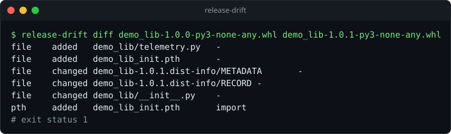
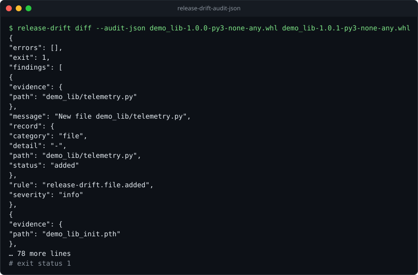

# release-drift

[](https://pypi.org/project/release-drift/) [](https://github.com/jacob-adm/release-drift/blob/main/pyproject.toml) [](https://github.com/jacob-adm/release-drift#licence)

release-drift compares two releases of a package, and a release with the git tag it was built
from, before you install it. It reports which files changed, which new code runs at install or
interpreter start-up, which dependencies the release adds, and which files of the release are not
in the project's tagged source.

Recent supply-chain attacks used these places: a `.pth` file in a PyPI wheel, which
[Python runs at every start](https://docs.python.org/3/library/site.html)
([LiteLLM 1.82.8](https://docs.litellm.ai/blog/security-update-march-2026)); npm releases
published with a stolen maintainer account or token
([axios](https://github.com/axios/axios/issues/10636),
[Cline](https://github.com/cline/cline/security/advisories/GHSA-9ppg-jx86-fqw7)); and npm
`preinstall` scripts
([tensorlake](https://github.com/tensorlakeai/tensorlake/security/advisories/GHSA-8g63-53c9-65j2)). A new `.pth` file, install script or dependency is a record in
release-drift's output, and so is a file in a release that is not in the project's tag.

release-drift only reports. It does not decide whether a package is malicious, and it does not
block or quarantine anything; what to do with a record is up to you, for example a required
check in CI. There is no AI and no scoring: the same inputs always give byte-identical output.

It is one of six audit tools that print the same result format with `--audit-json`.
[suite-gate](https://github.com/jacob-adm/suite-gate) runs them together and gives one verdict per
branch, as a command, a GitHub Action or an MCP server for coding agents.

## Example output

Two demo wheels, where the newer one adds a module and a `.pth` file that imports it at
interpreter startup:

<p align="center"></p>

The same comparison with `--audit-json` (first lines of the result):

<p align="center"></p>

## Requirements

- Python 3.9 or later, standard library only.
- git, for `release-drift source`.
- No platform-specific code; the tests run on Linux, macOS and Windows in CI.
- Network access only for `fetch`, `provenance` and `lockfile`.

## Install

From PyPI:

```
pip install release-drift
```

From a clone:

```
git clone https://github.com/jacob-adm/release-drift
cd release-drift
pip install .
```

pip installs `release-drift` as a console script. Without installing, it runs from a clone as
`python3 -m release_drift`.

## How it works

1. **Get the artifacts.** Download the wheel, sdist or npm tarball of each version, or let
   `release-drift fetch` download them from PyPI or npm and check them against the registry's
   digests.
2. **Read them without unpacking.** Each artifact is read into memory. Absolute paths, `..`,
   links leading outside the archive, device files and oversized members are refused; nothing
   from the artifact is written to disk and nothing is run.
3. **Find the execution surfaces.** `.pth` files, `sitecustomize.py`, `setup.py` and build
   backends, npm `preinstall`, `install`, `postinstall` and `prepare` scripts, `.pyc` files
   without source, native binaries (ELF, Mach-O, PE, WebAssembly) and links; also URL hosts and
   long base64 or hex strings.
4. **Compare.** `diff` lists the files added, removed or changed between two releases, and the
   surfaces, hosts and strings that are new. `source` lists the files of a release that are not,
   as they are, in git at a tag, apart from a documented list of files packaging tools generate.
5. **Check how it was published.** `provenance` compares the registry's record of two versions:
   a release without the provenance attestation the previous one had, one built by another
   workflow, or an npm release without provenance from another account.
6. **Act on the result.** release-drift exits 1 when it finds something, 0 when it finds nothing
   and 2 on an error, like `grep`. A finding is a new or changed execution surface, a new URL host
   or encoded string, or, for `source`, a file not in the tag. Files that merely changed between
   two releases are listed but are not findings.

## Commands

```
release-drift diff OLD NEW [--json] [--informational LIST]    compare two artifacts
release-drift source ARTIFACT --repo DIR --ref REF             files not in git at REF
      [--prefix PATH] [--json]
release-drift lockfile OLD NEW [--json] [--informational LIST] compare every package a
      [--type {sdist,wheel}] [--cache DIR] [--no-provenance]   lockfile change upgrades
release-drift provenance {pypi,npm} NAME OLD NEW               how each version was
      [--json] [--informational LIST]                          published: provenance, npm account
release-drift fetch {pypi,npm} NAME VERSION DIR                download one version; no install
      [--type {sdist,wheel,all}]
```

Output is one TAB-separated record per line: `CATEGORY`, `STATUS`, `PATH`, `DETAIL`, sorted;
`lockfile` adds `NAME`, `OLD` and `NEW` in front.
`--json` prints a JSON array instead, and `--audit-json` one object in the audit result format
shared with other audit tools, with a rule, severity, message and evidence for each record (see
[Commands](https://github.com/jacob-adm/release-drift/blob/main/docs/commands.md#audit-result-output)). `fetch` downloads only the sdist from PyPI unless `--type`
says otherwise.

## Quick start

Compare two releases of `six`:

```sh
mkdir old new
release-drift fetch pypi six 1.16.0 old
release-drift fetch pypi six 1.17.0 new
release-drift diff old/six-1.16.0.tar.gz new/six-1.17.0.tar.gz
echo $?
```

```text
build	changed	setup.py	setup.py
file	changed	CHANGES	-
file	changed	LICENSE	-
file	changed	PKG-INFO	-
file	changed	README.rst	-
file	changed	documentation/conf.py	-
file	changed	documentation/index.rst	-
file	changed	setup.cfg	-
file	changed	setup.py	-
file	changed	six.egg-info/PKG-INFO	-
file	changed	six.py	-
file	changed	test_six.py	-
1
```

`fetch` downloads the sdist and prints the path it saves. In the diff, no file was added and no new
start-up hook, install script, binary or URL host appeared. The exit status is 1 because
`setup.py`, which runs when the sdist is built, changed: `build changed setup.py` is a finding.
The `file changed` records are listed but are not findings; the two wheels of the same versions,
in which no build script runs, give exit 0. Then check the release against its tag:

```sh
git clone https://github.com/benjaminp/six
release-drift source new/six-1.17.0.tar.gz --repo six --ref 1.17.0
echo $?
```

```text
0
```

Every file of the sdist is in the tag `1.17.0`, apart from the files setuptools generates.

## Documentation

- [For coding agents](https://github.com/jacob-adm/release-drift/blob/main/docs/AGENTS.md): how an agent runs release-drift, reads `--audit-json` and cites the evidence.
- [Commands](https://github.com/jacob-adm/release-drift/blob/main/docs/commands.md): each command's input, records, options and exit status.
- [Running it in CI](https://github.com/jacob-adm/release-drift/blob/main/docs/ci.md): a tested GitHub Actions workflow for pull requests that change a lockfile, and a pre-commit hook.
- [Findings on ordinary releases](https://github.com/jacob-adm/release-drift/blob/main/docs/noise.md): how often a finding appears for 199 ordinary releases of popular PyPI and npm packages, and by which category.
- [Source comparison](https://github.com/jacob-adm/release-drift/blob/main/docs/source-comparison.md): which generated files `source` accepts, and why.
- [Limitations and security](https://github.com/jacob-adm/release-drift/blob/main/docs/limitations-and-security.md): what release-drift reads, refuses
  and does not detect.
- [Using it with other tools](https://github.com/jacob-adm/release-drift/blob/main/docs/other-tools.md): tested stacks for releases
  and dependency bumps, and GuardDog and Socket, and what release-drift adds.
- [Contributing](https://github.com/jacob-adm/release-drift/blob/main/CONTRIBUTING.md): running the tests and contributing a change.
- [Reporting a vulnerability](https://github.com/jacob-adm/release-drift/blob/main/SECURITY.md)

## License

Apache License 2.0; see [LICENSE](https://github.com/jacob-adm/release-drift/blob/main/LICENSE).
